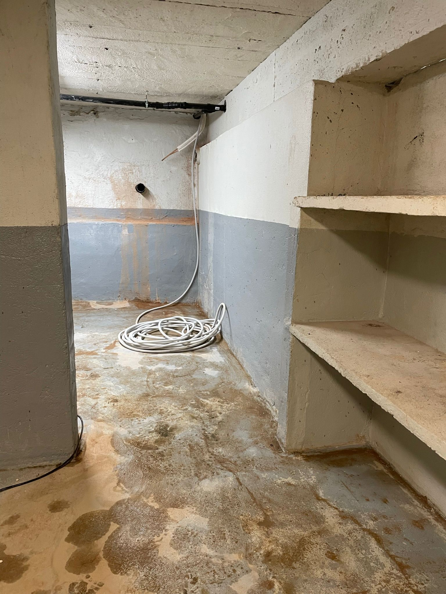
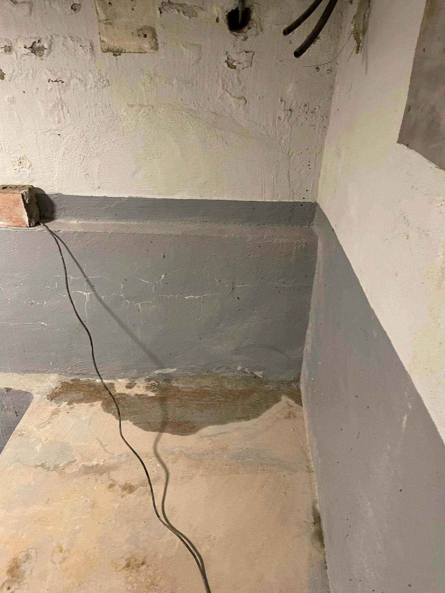
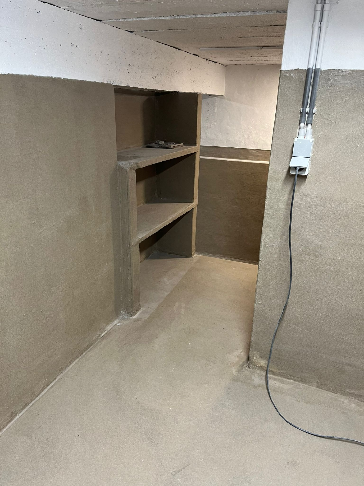
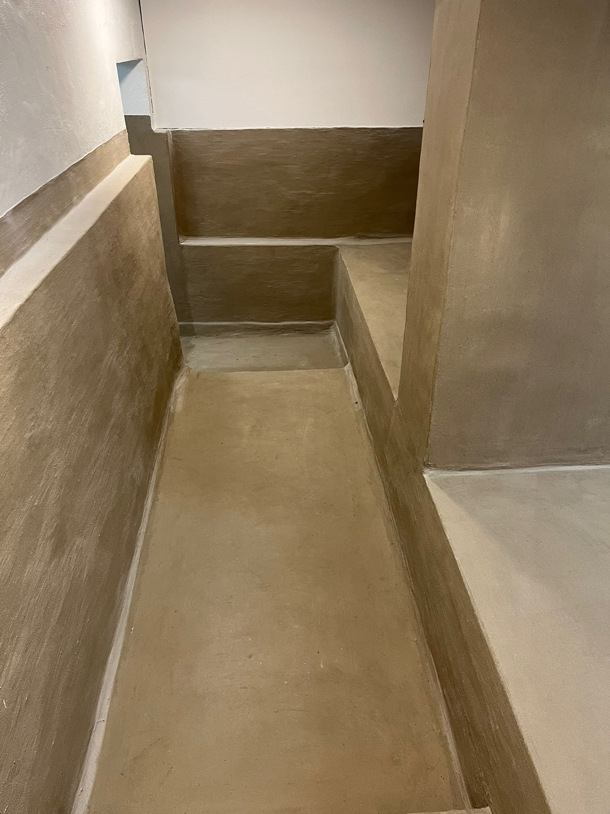
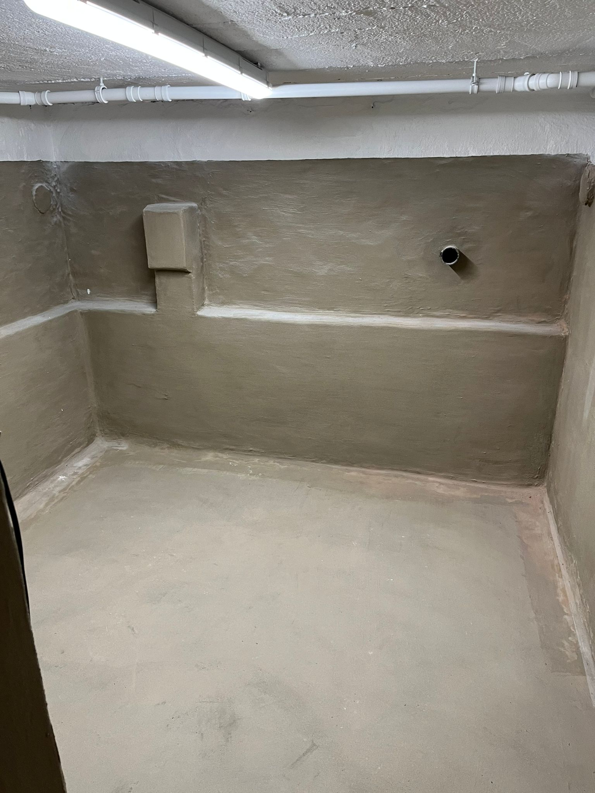

Een gemetste kelder is op zich niet waterdicht en dat kan voor heel wat vochtproblemen zorgen. Door uw kelder aan de binnenkant af te dichten, worden lekkages voorkomen. Gelukkige bestaan er verschillende manieren om je kelder waterdicht te maken zoals o.a. het aanbrengen van een kelderbekuiping. Bij een kelderbekuiping worden de kelder- of vloerwanden dichtgemaakt met een soort waterdichte pasta.

**VOOR & NA**

Vocht zoekt de weg van de minste weerstand. Meestal op plekken waar verschillende bouwdelen bij elkaar komen. Bijvoorbeeld de aansluiting tussen de muur en de vloer. Het kan ook zijn dat de lekkage pas later ontstaat, door verzakking van de woning. Het probleem komt keer op keer terug. Drukkend grondwater is hier de oorzaak van. De grondwaterstand wisselt. Ook het zakkende water na een hevige regenbui zorgt voor wateroverlast. Nu de regenbuien steeds extremer worden, zal ook de wateroverlast in uw kelder toenemen.

Wij hebben al meer dan 1.000 kelders waterdicht gemaakt. Voordat we aan de slag gaan, inspecteren wij uw kelder zorgvuldig. We beoordelen het soort, de dikte en de bijzonderheden van de bestaande muren en vloeren. Het is belangrijk om ter plekke een zorgvuldige opname te maken. Bij de inspectie van de kelder nemen we uw wensen en de eigenschappen van de kelder op. Op basis hiervan bepalen we hoe we het beste resultaat kunnen behalen.

Ook vochtproblemen? Contacteer ons
