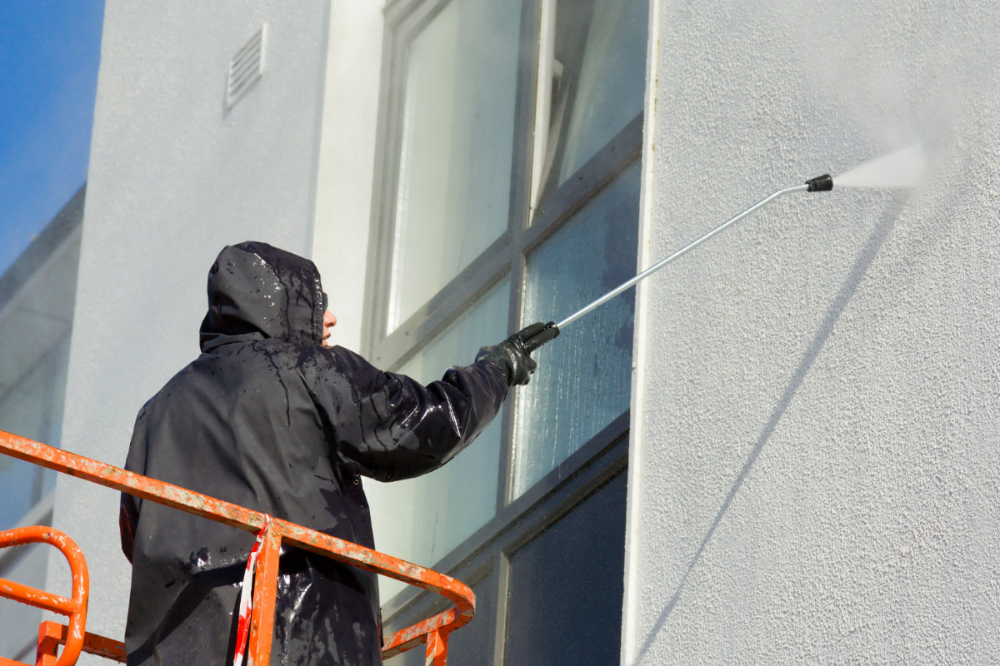

## Qu’est-ce que l’humidité par infiltration ?

L’humidité par infiltration, aussi appelée pénétration de la pluie, c’est de l’eau de pluie qui traverse la façade depuis l’extérieur. La brique non traitée est poreuse et absorbe facilement l’eau. Les joints ouverts, les interstices et les fissures laissent aussi passer l’eau. C’est surtout le cas sur la façade exposée, qui subit le plus la pluie battante.

Votre façade a un rôle important : elle protège votre maison de la pluie, du vent et du froid. Après des années de pluie, de vent et de soleil, les joints et les briques s’usent. C’est normal, mais cela augmente le risque d’infiltrations.

## Un mur intérieur humide après la pluie : les causes

L’eau de pluie entre le plus souvent par l’un de ces points :

- **Des briques poreuses :** une brique tendre ou ancienne absorbe beaucoup d’eau. Lors d’une pluie battante prolongée, le mur se sature.
- **Des joints usés :** les joints creux, fissurés ou érodés absorbent plus d’eau que la brique elle-même.
- **Des fissures dans la façade :** des tassements ou des écarts de température créent des fissures dans la brique, les joints ou l’enduit.
- **Les raccords autour des fenêtres et des portes :** un interstice mal fermé, un seuil sans bonne évacuation de l’eau ou un joint de mastic abîmé.
- **Gouttières, descentes d’eau et couvre-murs :** une gouttière qui fuit ou un couvre-mur défectueux sur un mur de jardin ou une rive de toit mouille fortement la façade à cet endroit.
- **Des problèmes dans le mur creux :** des restes de mortier ou des débris dans la coulisse peuvent former un pont entre le parement et le mur intérieur, et l’eau atteint alors l’intérieur.

Souvent, plusieurs causes jouent en même temps. Un hydrofuge sur une façade avec des gouttières qui fuient ou des joints ouverts ne règle pas le problème. Nous traitons donc d’abord les fuites et les dégâts.

## Les conséquences

- **Une facture d’énergie plus élevée :** un mur mouillé isole moins bien, vous devez donc chauffer davantage.
- **Un climat intérieur humide :** l’humidité s’évapore vers l’intérieur. La pièce semble froide et humide, et monter le chauffage n’y change rien.
- **Des moisissures :** l’air plus humide est un terrain idéal pour les moisissures, mauvaises pour votre santé.
- **Des dégâts aux finitions :** l’enduit, le papier peint et la peinture se décollent, avec des frais de réparation à la clé.
- **Des dégâts de gel :** l’eau dans une brique saturée gonfle quand il gèle. Les briques et les joints éclatent, et la façade absorbe encore plus d’eau.

## Un bon traitement commence par un bon diagnostic

Il existe plusieurs traitements, et le bon choix dépend de la cause. C’est pourquoi nous commençons toujours par un diagnostic gratuit sur place. Vous ne payez ainsi pas pour une solution qui ne règle pas votre problème.

Vous n’êtes pas sûr qu’il s’agisse d’humidité par infiltration ? Faites d’abord notre [test d’humidité en ligne](/fr/test-humidite).

## Rendre votre façade hydrofuge

Un hydrofuge est une imprégnation incolore, le plus souvent à base de silanes ou de siloxanes. Le produit pénètre dans les pores de la brique et des joints et les rend hydrofuges. La pluie perle et ne pénètre plus profondément dans le mur. Les pores restent ouverts, pour que la vapeur d’eau puisse sortir du mur. On dit que le traitement est perméable à la vapeur.

Un hydrofuge ne ponte pas les fissures ni les joints ouverts. Nous les réparons donc au préalable. Une façade sale, ou couverte de mousses et d’algues, est d’abord nettoyée pour que le produit pénètre bien dans le support.

## Hydrofuge, rénovation de façade ou autre chose ?

Tous les murs humides ne demandent pas le même traitement :

- **Façade en bon état, mais poreuse :** un hydrofuge suffit souvent.
- **Beaucoup de joints usés, des briques abîmées ou des fissures :** il faut d’abord une [rénovation de façade](/fr/renovation-facade). L’hydrofuge vient en dernière étape.
- **Façade encrassée, avec mousses ou algues :** nous la nettoyons d’abord avec une [technique de nettoyage](/fr/techniques-de-nettoyage) adaptée.
- **Des taches au bas du mur, toute l’année :** cela indique plutôt de l’[humidité ascensionnelle](/fr/humidite-ascensionnelle).
- **Des moisissures dans les coins et derrière les meubles, surtout en hiver :** c’est souvent de la condensation. Plus d’infos sur la [ventilation et les moisissures](/fr/ventilation-moisissures).

Vous prévoyez d’[isoler](/fr/isolation) le mur creux ou la façade ? Veillez à ce que la façade extérieure soit d’abord sèche et hydrofuge. Une façade mouillée isole mal.

## Combien coûte le traitement de l’humidité par infiltration ?

Le prix dépend de l’état de votre façade et des travaux nécessaires. Nous utilisons les mêmes traitements de façade que pour la [rénovation de façade](/fr/renovation-facade), chacun calculé au m² de façade :

- **L’hydrofuge :** au m², une imprégnation incolore et perméable à la vapeur.
- **Le rejointoiement :** dégarnissage et nouveaux joints au m². Le prix dépend de la profondeur des joints et du type de brique.
- **Le nettoyage :** au m², si la façade doit d’abord être nettoyée.

Ce qui détermine aussi le prix total :

- **La surface :** le nombre de m² de façade à traiter.
- **L’état des joints et des briques :** combien de joints et de briques doivent d’abord être réparés.
- **La hauteur et l’accès :** une façade haute demande un échafaudage ou une nacelle élévatrice.
- **Les réparations complémentaires :** gouttières, couvre-murs ou raccords autour des fenêtres.

Vous trouverez les prix indicatifs dans l’indication de prix sur cette page. Ces prix sont indicatifs. Le prix exact suit le diagnostic gratuit sur place. Ce diagnostic est gratuit partout, y compris aux Pays-Bas et en Wallonie. Un montant minimum s’applique par chantier. Vous êtes un professionnel ? Vous recevez nos prix hors TVA sur demande.

Nous vous contactons dans les 2 jours ouvrables et vous recevez le devis dans la semaine qui suit le diagnostic. [Demandez votre devis ici](/fr/demande-devis?probleem=doorslaand-vocht).

## Garantie

Le traitement de façade contre l’humidité par infiltration est couvert par une garantie de 10 ans. Elle s’applique à l’hydrofuge, au rejointoiement, au nettoyage et aux réparations repris dans le devis. Les dégâts dus à une nouvelle cause, comme une gouttière qui fuit ou un couvre-mur abîmé, ne sont pas couverts. Une garantie plus longue ne s’applique qu’au traitement contre l’[humidité ascensionnelle](/fr/humidite-ascensionnelle).

Nous travaillons avec plus de 20 ans d’expérience pour des particuliers, des syndics, des architectes et des entrepreneurs, en Belgique et aux Pays-Bas. Du diagnostic à la réception des travaux, vous avez un seul interlocuteur.
